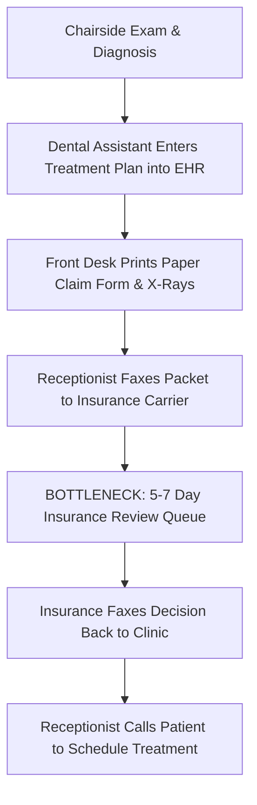
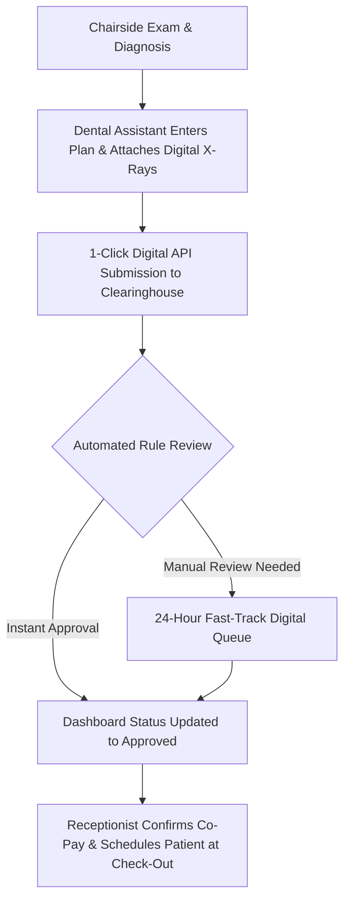

# As-Is vs. To-Be Process Maps: Insurance Prior-Authorization
**Author|** Business Analyst

**Date|** October 2026

## Objecctive
The objective of this document is to visually map and analyze the operational workflow of dental insurance prior-authorizations. By contrasting the current manual, fax-heavy "As-Is" process with an automated, digital-first "To-Be" workflow, this analysis identifies critical bottlenecks, eliminates administrative waste, and establishes a streamlined path to achieve 24-hour authorization turnarounds.

---

## As-Is Process (Current State)
**Dentist:** Diagnoses the patient during an exam and writes a paper treatment plan for a crown.
**Receptionist:** Receives the paper plan at the front desk, opens the patient's chart, and manually fills out a 4-page paper insurance claim form.
**Receptionist:** Prints out diagnostic X-rays, attaches them to the paper form, and faxes the packet to the insurance provider.
**Insurance Company:** Receives the fax, places it in a queue, and takes 3–5 business days to review it.
**Insurance Company:** Faxes back an approval or denial letter to the clinic.
**Receptionist:** Checks the fax machine, reads the approval, and manually calls the patient to schedule their treatment appointment.

---

---

## To-Be Process (Future State)
**Chairside Exam & Entry:** Dentist diagnoses; Dental Assistant enters the treatment plan and attaches digital X-rays directly to the electronic record.
**Instant Digital Submission:** System automatically package-submits the claim, treatment codes, and X-rays to the clearinghouse portal via API with one click.
**Automated Eligibility & Real-Time Decision:** The clearinghouse runs automated checks against insurance rules, granting near-instant approvals for standard codes or routing complex cases into a fast-tracked 24-hour digital queue.
**Instant Front-Desk & Patient Notification:** The receptionist sees an updated "Approved" flag directly on their dashboard and can review co-pays with the patient before they even walk out of the clinic to schedule their treatment.

---

---

## Key Operational Wins
* Elimination of paper/fax supplies
* Removal of multi-day queue delays
* Immediate patient scheduling at check-out
